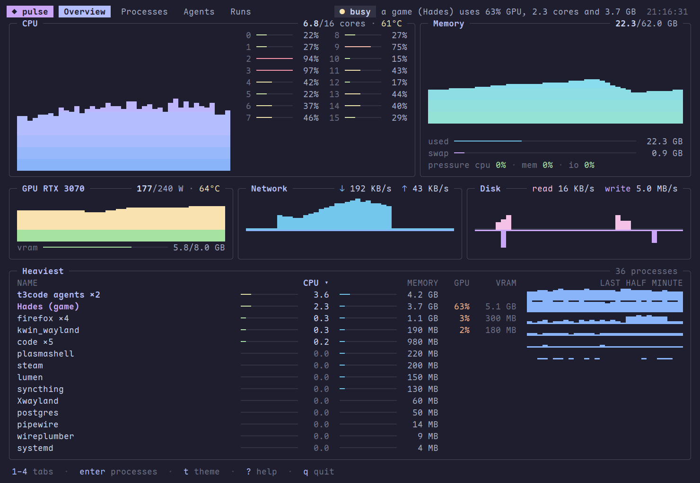

# Pulse

Pulse says what is using this machine. On a terminal it is a full-screen monitor; for AI coding agents, which pay for every line they read, and for scripts it is a dozen lines.



Agents and scripts get the card instead (`pulse -A` prints it on a terminal too):

```
$ pulse
busy: a game (Hades) uses 68% GPU, 2.1 cores and 3.7 GB; cpu at 8.0 of 16 cores, most from t3code agents ×2 (5.6 cores)
cpu 8.0/16 cores 61°C · mem 24.0/62.0 GB, no pressure · gpu RTX 3070 71% at 168/240 W, 5.8/8.0 GB, 64°C
top  t3code agents ×2  5.6 cores  4.2 GB
     Hades (game)      2.1 cores  3.7 GB  68% gpu  5.1 GB vram
     firefox ×4        0.4 cores  1.1 GB   3% gpu  300 MB vram
next: pulse tree 200.yqw   the 3 processes of Hades (game)
next: pulse agents         the 2 agents, by thread
next: pulse top --by mem   the biggest memory users
```

It's a personal tool for one Linux machine where agents run in [T3 Code](https://t3.codes) while the same machine is used for gaming. Elsewhere it shows less, but doesn't break.

## Install

```sh
go install github.com/Vaspyyy/pulse@latest
ln -s "$PWD/skill" ~/.claude/skills/pulse   # from a checkout, for agents
```

## The monitor

`pulse` alone on a terminal opens it (`pulse tui` does the same from anywhere). It reads the machine once a second and has four tabs:

| Tab | Shows |
| --- | --- |
| Overview | CPU with a meter for every core, memory and swap, GPU power and VRAM, network and disk rates, each with its last minutes as a graph, over the heaviest groups and how each did in the last half minute |
| Processes | groups (a game, T3's agents, a program with its helpers), every process, or the tree; beside the list, everything known about the selected line: command, state, agent thread, game, cgroup |
| Agents | T3 Code's agents by thread, their memory against T3's limit, what the selected agent runs and how its CPU and memory went lately |
| Runs | what `pulse run` recorded, with CPU and memory over time; two marked runs are compared |

| Key | Does |
| --- | --- |
| `1` to `4`, `tab` | switch tabs |
| arrows, `j` `k`, `pgup` `pgdn`, `g` `G`, mouse | move; a click selects, the wheel scrolls |
| `enter` | open or close a group |
| `v` | groups, all processes, or the tree |
| `s` | sort by CPU, memory or GPU |
| `/` | filter by name; `esc` clears it |
| `x` | end the selected process, after asking: `enter` sends SIGTERM, `shift+k` SIGKILL |
| `space` | mark a run; two marked runs are compared |
| `t` | the next theme: mocha, tokyo, gruvbox, latte, the terminal's own colours, or lumen |
| `?` `q` | help, quit |

The theme and the tab are remembered. `theme = gruvbox` in the config file sets the theme to start with, and with `NO_COLOR` set Pulse keeps to the terminal's colours.

## In lumen

[lumen](https://github.com/Vaspyyy/lumen) is the terminal made for these tools, and Pulse does a little more in it. Nothing here is needed elsewhere, and other terminals see the same output as before.

- **The monitor wears lumen's colours** on lumen's own background, so the blur shows through. `t` still switches themes.
- **Handles, run ids and `next:` lines are links.** A click puts the command at the prompt: `pulse tree 4821.kfx` for a handle, `pulse show r7k2mq` for a run, the line itself for a `next:`. It is put there, not run.
- **A long `pulse run` says when it is over**, with a standard notification sequence, so a terminal can mark the tab you looked away from. Ten seconds counts as long; `notify_after` in the config file changes that.
- **`pulse watch --json`** is what a terminal reads to show the load in its title bar and what each tab uses: one JSON line per reading, with a total for every pid it was asked about. A line `pids 4821 5133` on its standard input changes the pids without a new start.

`links = on` in the config file turns the links on in another terminal that knows what to do with them. [docs/design.md](docs/design.md) has the exact formats.

## Commands

| Command | Prints |
| --- | --- |
| `pulse` | the card: load verdict, machine summary, heaviest groups |
| `pulse load` | one line: `quiet`, or `busy` with the reasons |
| `pulse top [--by cpu\|mem\|gpu]` | the heaviest groups of processes |
| `pulse tree <handle\|pid\|name>` | a process and what it started, with totals |
| `pulse agents` | T3's agents: thread, model, CPU, memory, and their memory limits |
| `pulse watch [--json] [--every s] [--pids p,p] [-n readings]` | a reading every 3 seconds, one line each, until stopped: the load, and what each pid runs and uses |
| `pulse run [-n name] -- <command>` | runs a command and records what it used |
| `pulse runs` | the recorded runs |
| `pulse show [run]` | one run: numbers, processes, timeline |
| `pulse diff [run] [run]` | two runs side by side |

```
$ pulse run -n after -- cargo test
pulse: cargo test, exit 0, 61.0 s, recorded as r9q4xt (after)
  cpu    701 s (660 user, 41.0 sys), 11.5 cores on average
  peak   11.5 GB private memory (sampled every 100 ms); largest process 4.4 GB RSS (pulse-test)
  stall  cpu 9.8 s, memory 1.2 s, io 0.6 s
  other  a game (Hades), 2.1 cores on average: wall time isn't comparable with a quiet run's

$ pulse diff before after
cargo test in pulse: abc123f (r7k2mq, 11-08 21:14) vs def4567 (r9q4xt, 11-09 22:40)
                 before             after              change
wall             48.2 s             61.0 s             +27 %
cpu              653 s              701 s              +7 %
peak memory      8.9 GB             11.5 GB            +2.6 GB
largest process  rustc syn 2.1 GB   pulse-test 4.4 GB  +2.3 GB
note: r9q4xt overlapped other load, so its wall time isn't comparable
next: recap abc123f..def4567   what changed between the two runs
```

Inside a T3 agent, a run gets a cgroup of its own below the agent's scope, so its CPU time and stall times are exact however it forks, and T3's limits and stop button still cover it.

GPU numbers come from NVML for NVIDIA (loaded at runtime, no cgo) and from sysfs for AMD. When "busy" starts, and which other programs count as games, is set in `~/.config/pulse-monitor/config`: `pulse help config` lists the keys.

[skill/SKILL.md](skill/SKILL.md) explains the output. [docs/design.md](docs/design.md) is the plan: what exists is milestones M0, M1 and M2; the Prism integration is still to come.

## Development

```sh
go test ./...                             # inside a T3 agent, this also checks the live T3 layout; with an NVIDIA GPU, a live NVML reading
go test ./internal/cli -update            # rewrite the golden outputs
go test ./internal/tui -update            # rewrite the monitor's golden frames
go test ./collect/t3 -capture 2026-12-01  # save today's T3 layout as a fixture
```

No test opens a window or a terminal: the monitor's tests draw its frames in memory. To see where its time goes, `PULSE_PROFILE=cpu.prof pulse` writes the monitor's CPU profile (and its heap to `cpu.prof.heap` when it quits), and `PULSE_LIVE_BENCH=1 go test ./internal/tui -run xxx -bench Live` times one reading and one frame on the running machine.

## License

GPL-3.0-or-later. See [LICENSE](LICENSE).
